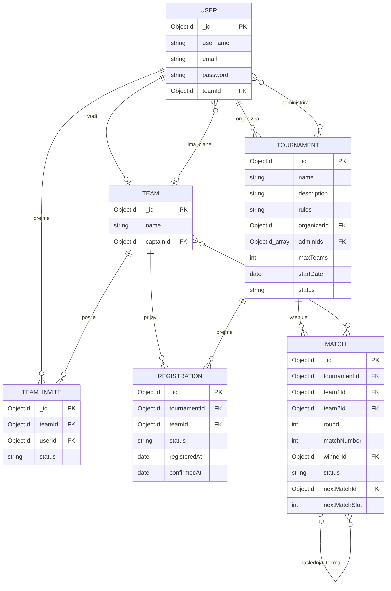

# Podatkovni model

Za shranjevanje podatkov bo uporabljena podatkovna baza MongoDB, za povezovanje z Node.js pa knjižnica Mongoose. Podatkovni model bo sestavljen iz šestih glavnih zbirk.

## Opis podatkovnega modela

Za shranjevanje podatkov bo uporabljena podatkovna baza MongoDB, za povezovanje z aplikacijo pa knjižnica Mongoose. Podatkovni model bo sestavljen iz šestih med seboj povezanih zbirk.

### USER
Hrani podatke o registriranih uporabnikih, kot so uporabniško ime, elektronski naslov in geslo. Vsak uporabnik lahko pripada največ eni ekipi.

### TEAM
Hrani podatke o ekipah, njihovih imenih in vodjih (`captainId`). Posamezna ekipa lahko vsebuje največ pet igralcev.

### TEAM_INVITE
Hrani povabila uporabnikov v ekipe. Vsako povabilo povezuje uporabnika z ekipo in vsebuje stanje povabila (pending, accepted, rejected).

### TOURNAMENT
Hrani podatke o turnirjih, njihovih pravilih, datumih in omejitvah. Vsak turnir ima organizatorja (`organizerId`) in lahko vsebuje več administratorjev (`adminIds`). Administratorji imajo pravice samo na turnirjih v katere so bili dodani.

### REGISTRATION
Povezuje ekipe s turnirji in hrani stanje njihove prijave. Omogoča tudi spremljanje potrditve pripravljenosti ekip v fazi lock-in.

### MATCH
Hrani podatke o posameznih tekmah, ekipah, rezultatih in zmagovalcih. S poljema `nextMatchId` in `nextMatchSlot` omogoča povezovanje tekem ter samodejno napredovanje zmagovalcev v naslednji krog turnirja.

## Povezave med zbirkami

Zbirke so med seboj povezane z referencami `ObjectId`. Uporabnik lahko pripada največ eni ekipi, posamezna ekipa pa lahko sodeluje na več turnirjih. Vsak turnir vsebuje več prijav in tekem. Posamezne tekme so povezane med seboj, kar omogoča samodejno posodabljanje bracketa.

