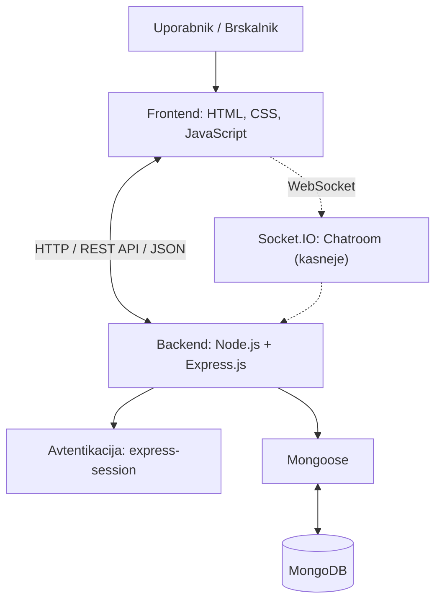

# Arhitektura in tehnološki sklad

## Arhitektura

Aplikacija DemaciaHub bo temeljila na arhitekturi odjemalec–strežnik, ki bo sestavljena iz treh glavnih delov:

- **Frontend:** Uporabniški vmesnik za pregled turnirjev, upravljanje ekip in spremljanje bracketov.
- **Backend:** Strežnik za obdelavo zahtevkov, upravljanje uporabnikov, preverjanje pravic in izvajanje logike turnirjev.
- **Podatkovna baza:** MongoDB za shranjevanje podatkov o uporabnikih, ekipah, turnirjih in tekmah.

Frontend in backend bosta komunicirala prek REST API-ja z uporabo HTTP zahtevkov v formatu JSON. Backend bo do podatkovne baze dostopal preko knjižnice Mongoose.

Za avtentikacijo bo uporabljen express-session. Pravice uporabnikov se bodo določale glede na njihovo vlogo pri posameznem turnirju.

Za lokalni zagon bo treba namestiti potrebne pakete z `npm install`, nastaviti povezavo do MongoDB in zagnati strežnik z `npm run dev`. Za samodejni ponovni zagon strežnika bo uporabljen nodemon.

## Tehnološki sklad

| Del sistema | Tehnologije |
| ----------- | ----------- |
| Frontend | HTML, CSS, JavaScript |
| Backend | Node.js, Express.js |
| Podatkovna baza | MongoDB |
| Podatkovni modeli | Mongoose |
| Avtentikacija | express-session |
| Lokalni razvoj | npm, nodemon, VS Code |
| Komunikacija | REST API, HTTP, JSON |
| Chatroom (kasneje) | Socket.IO |

## Arhitekturne odločitve

- **JavaScript:** Uporaba istega jezika na frontendu in backendu poenostavi razvoj aplikacije.
- **Node.js in Express.js:** Omogočata izdelavo strežnika in REST API-ja.
- **MongoDB in Mongoose:** Omogočata preprosto shranjevanje podatkov v dokumentih in povezovanje zbirk.
- **express-session:** Omogoča upravljanje prijavljenih uporabnikov s sejami.
- **REST API:** Omogoča ločeno komunikacijo med frontendom in backendom.
- **Socket.IO:** V prihodnosti bo omogočal komunikacijo v realnem času med igralci in administratorji.

